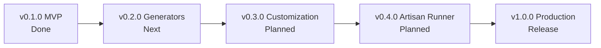

# Project Status & Development Roadmap

**Project:** Laravel Developer Toolkit (`laravel-dev-toolkit`)  
**Repository:** [github.com/sajusun/laravel-dev-toolkit](https://github.com/sajusun/laravel-dev-toolkit)  
**Current Version:** `v0.1.0 (MVP)`  
**License:** MIT  
**Last Updated:** 2026-10-24  

---

## 1. Executive Summary & Health Check

| Metric | Status | Details |
|---|---|---|
| **Build & Compilation** | :white_check_mark: Passing | TypeScript strict mode compilation (`npm run compile`) |
| **ESLint** | :white_check_mark: Passing | Zero errors / warnings (`npm run lint`) |
| **Prettier** | :white_check_mark: Passing | 100% formatted (`npm run format-check`) |
| **Automated Tests** | :white_check_mark: 28/28 Passing | 100% pass rate in unit tests (`npm test`) |
| **Bundle Size** | :white_check_mark: 12.6 KB | Minified single file (`dist/extension.js`) via esbuild |
| **VSIX Package** | :white_check_mark: Ready | `laravel-developer-toolkit-0.1.0.vsix` (11.87 KB) |
| **CI / CD** | :white_check_mark: Configured | GitHub Actions across Ubuntu, Windows, macOS |

---

## 2. Completed Milestones (v0.1.0 MVP)

**Completion Date:** 2026-10-24  
**Git Commit:** Initialized and pushed to `main` branch.

### Features Delivered:
- [x] **Project Detection Engine (`src/services/laravelDetector.ts`)**:
  - Automatically identifies Laravel root folders using `artisan`, `app/`, and `composer.json`.
  - Safely ignores `node_modules`, `vendor`, and `.git` folders for high performance.
  - Multi-root and nested Laravel folder detection.
- [x] **Controller Generator (`src/commands/createController.ts`)**:
  - Four modes: **Plain**, **Resource** (full CRUD), **API Resource**, and **Invokable** (`__invoke`).
  - Supports deep subpaths (e.g., `Api/V1/Admin/OrderController`).
- [x] **Form Request Generator (`src/commands/createFormRequest.ts`)**:
  - Generates strongly-typed `authorize(): bool` and `rules(): array` boilerplate conforming to Laravel conventions.
- [x] **API Resource Generator (`src/commands/createApiResource.ts`)**:
  - Generates `JsonResource` classes with `toArray(Request $request): array`.
- [x] **PSR-4 Namespace Resolution (`src/services/namespaceResolver.ts`)**:
  - Parses `composer.json` autoload mappings dynamically to resolve correct namespaces regardless of target subfolder.
- [x] **Non-Destructive File Safety Engine (`src/services/fileGenerator.ts`)**:
  - Checks if a file already exists; prompts modal confirmation before overwriting.
  - Recursively creates parent directories when needed.
- [x] **PHP Identifier & Path Validator (`src/services/phpValidator.ts`)**:
  - Validates class names, blocks PHP reserved keywords (`class`, `switch`, `return`, etc.).
  - Blocks directory traversal attacks (`../`).
- [x] **Explorer Context Menu Integration**:
  - Right-click any folder in VS Code to generate classes directly into that directory.
- [x] **28 Comprehensive Unit Tests**:
  - Covers validator, template generation, namespace resolver, file safety, and project detector.

---

## 3. Immediate Next Steps (Pre-Release Checklist)

Before releasing to the public VS Code Marketplace:

1. **Update `package.json` Metadata**:
   - Change `"publisher": "placeholder-publisher"` to your actual VS Code Marketplace publisher ID (e.g. `sajusun`).
   - Confirm repository URL: `https://github.com/sajusun/laravel-dev-toolkit`.
2. **Add Extension Icon**:
   - Place a `128x128` PNG logo at `./icon.png` and add `"icon": "icon.png"` in `package.json`.
3. **Capture Product Screenshots / GIFs**:
   - Command Palette selection.
   - Controller QuickPick.
   - Explorer Right-Click Context Menu.
   - Generated code in editor.
   - Add them to `README.md`.
4. **Marketplace Publishing Token**:
   - Create a Personal Access Token (PAT) on Azure DevOps.
   - Run `npx @vscode/vsce login <publisher-name>`.
   - Run `npx @vscode/vsce publish`.

---

## 4. Upcoming Version Roadmap

### Version 0.2.0 — Extended Generators
**Target Goal:** Provide complete support for Models, Migrations, Policies, and Tests.

- [ ] **Model Generator (`createModel.ts`)**:
  - Command: `Laravel Developer Toolkit: Create Model`
  - Options: Generate with Migration (`-m`), Factory (`-f`), Seeder (`-s`), Controller (`-c`).
  - Flags for SoftDeletes, HasFactory, and `$fillable = []`.
- [ ] **Migration Generator (`createMigration.ts`)**:
  - Command: `Laravel Developer Toolkit: Create Migration`
  - Automatically generates timestamped filenames (`YYYY_MM_DD_HHMMSS_create_..._table.php`).
  - Target folder: `database/migrations`.
- [ ] **Test Generator (`createTest.ts`)**:
  - Command: `Laravel Developer Toolkit: Create Test`
  - Choice between **Pest PHP** and **PHPUnit**.
  - Choice between Feature test (`tests/Feature`) and Unit test (`tests/Unit`).
- [ ] **Policy Generator (`createPolicy.ts`)**:
  - Command: `Laravel Developer Toolkit: Create Policy`
  - Standard policy methods: `viewAny`, `view`, `create`, `update`, `delete`, `restore`, `forceDelete`.

### Version 0.3.0 — Customization & Developer Experience
**Target Goal:** Allow developers and teams to configure conventions and custom templates.

- [ ] **Custom Stubs / Template Overrides**:
  - Support project-level `.vscode/laravel-templates/` or `stubs/` directory.
- [ ] **Configurable Settings (`package.json` contributes.configuration)**:
  - `laravelToolkit.defaultControllerType`: 'plain' | 'resource' | 'api' | 'invokable'.
  - `laravelToolkit.testFramework`: 'pest' | 'phpunit'.
  - `laravelToolkit.autoOpenGeneratedFiles`: boolean (default `true`).
  - `laravelToolkit.confirmOverwrite`: boolean (default `true`).

### Version 0.4.0 — Artisan Command Runner & Preview
**Target Goal:** Quick Artisan execution and file preview before write.

- [ ] **Generated File Preview**:
  - Show a diff/preview tab before committing file generation to disk.
- [ ] **Integrated Artisan Runner**:
  - Fast commands: `artisan route:list`, `artisan migrate`, `artisan optimize:clear`.
  - Executed via VS Code Terminal API with safe escaping.

### Version 1.0.0 — Marketplace Release & Long-Term Stability
**Target Goal:** Production-grade release, complete documentation, and enterprise readiness.

- [ ] End-to-end integration tests using `@vscode/test-electron`.
- [ ] Accessibility and keyboard shortcut optimizations.
- [ ] Multi-root workspace automated benchmarks.
- [ ] Public VS Code Marketplace & Open VSX Registry deployment.

---

## 5. Development & Maintenance Commands Reference

| Action | Command |
|---|---|
| **Install Dependencies** | `npm install` |
| **Compile TypeScript** | `npm run compile` |
| **Watch Mode (Dev)** | `npm run watch` |
| **Run Unit Tests** | `npm test` |
| **Check Code Style** | `npm run lint` && `npm run format-check` |
| **Fix Code Style** | `npm run format` |
| **Build Bundle (esbuild)** | `npm run build` |
| **Create Local `.vsix`** | `npm run package-vsix` |
| **Launch Extension Debugger** | Press `F5` in VS Code |
